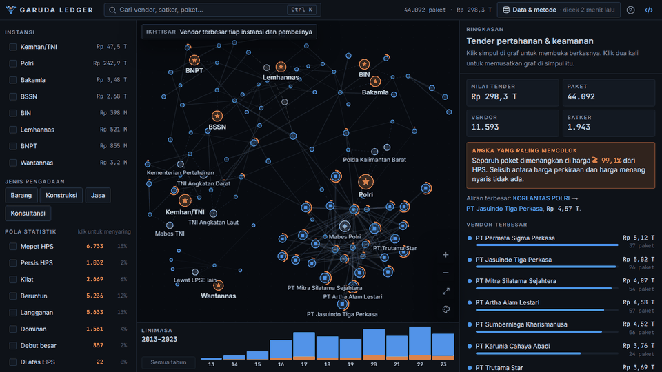
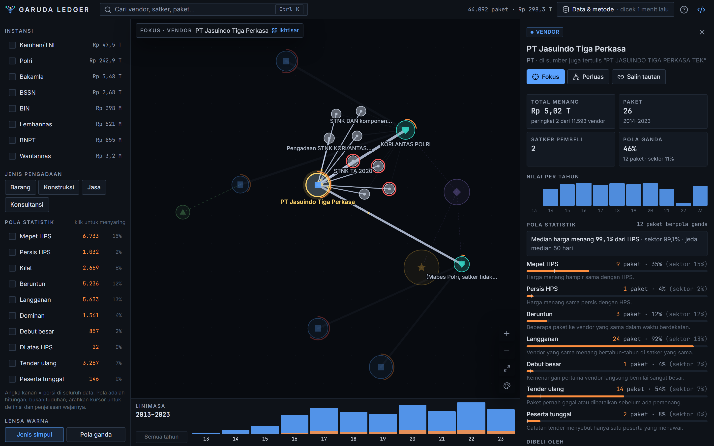
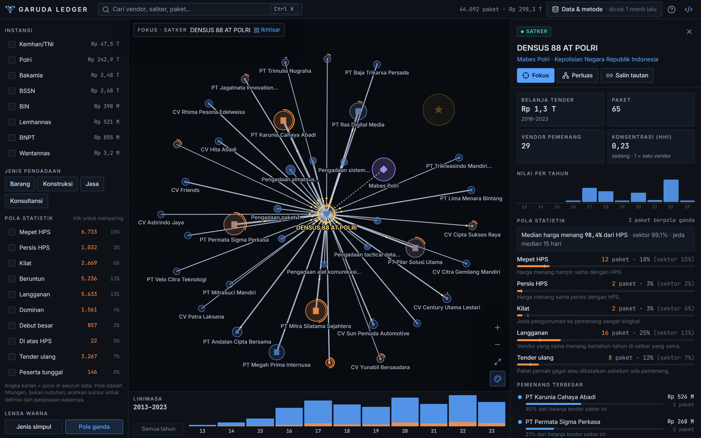

# Garuda Ledger

[](https://github.com/Avalon2222/garuda-ledger/actions/workflows/ci.yml)
[](https://github.com/Avalon2222/garuda-ledger/actions/workflows/refresh-harian.yml)
[](https://nextjs.org)
[](pipeline)
[](data/SUMBER_DATA.md)
[](LICENSE)

> **Secrets have budgets. Budgets leave receipts.**
> Graf investigasi ala Gotham untuk tender pertahanan dan keamanan Indonesia: 44.092 paket senilai Rp 298 triliun,
> 11.593 vendor, 1.943 satker di Kemhan, TNI, Polri, Bakamla, BSSN, BIN, Lemhannas, dan BNPT. Klik satu vendor, lihat
> siapa pembelinya, berapa nilainya, dan pola statistik apa yang muncul. Semuanya dari data pengadaan terbuka.

**Live:** segera di https://garuda-ledger.vercel.app (deploy belum jalan; sementara ini jalankan lokal, lihat
[Menjalankan sendiri](#menjalankan-sendiri))



<p align="center">
  
  
</p>

## 🇬🇧 In English

**A dark, smooth, Gotham-style link-analysis console for Indonesian defense and security procurement.** Vendors,
buying units, agencies, tenders and owners are nodes on a force-directed canvas; click any of them and a dossier
opens with the money, the counterparties and the statistical patterns behind it.

- **Explore** a graph of 44,092 awarded tenders (IDR 298 trillion, 2013–2023) across the Ministry of Defense and
  the armed forces, the National Police, Bakamla, BSSN, BIN and others. Click a node for its dossier, double-click
  to re-centre the graph on it, expand to pull in its neighbours.
- **Read the patterns**: ten per-tender flags computed from the data itself (award within 0.1% of the owner
  estimate, the same vendor winning at the same unit for five-plus years, three awards in thirty days, one vendor
  taking half a unit's spend, and so on). Every flag ships with its definition, the sector baseline and a
  legitimate explanation. They are statistics, never accusations.
- **Follow the pipeline**: a Python ETL streams 1.3 million OCDS records, keeps the 59,078 that belong to the
  sector, resolves 14,368 supplier records into 11,593 vendors with deliberately conservative entity resolution,
  and refuses to publish if any of ten data-quality gates fail. A GitHub Actions job re-checks the source every
  morning with conditional requests and rebuilds only when something changed.
- **Share** any view: selection, focus, filters and lens live in the URL.

Built with Next.js 16, TypeScript, Tailwind 4, d3-force and a hand-written Canvas 2D renderer. Data prepared with
dependency-free Python. Deployed on Vercel. Keyboard-driven and tested on phones (360, 390, 412 px) as well as
desktop. *The rest of this README is in Indonesian.*

## Mengapa

Anggaran pertahanan sering dibahas sebagai satu angka besar. Padahal sebagian besarnya dibelanjakan lewat ribuan
tender kecil yang diumumkan terbuka di LPSE: ransum, seragam, pelat nomor, kendaraan, gedung. Datanya publik, tapi
bentuknya puluhan ribu baris yang tidak enak dibaca.

Garuda Ledger mengubah baris-baris itu jadi graf. Pertanyaan seperti "vendor ini menang di mana saja?", "satker ini
belanjanya ke siapa?", atau "seberapa sering harga menang nyaris sama dengan HPS?" jadi bisa dijawab dengan beberapa
klik. Tujuannya membuat data terbuka terasa bisa dijelajahi, bukan menuduh siapa pun.

## Angka yang langsung kelihatan

| | |
|---|---|
| **99,1%** | Median harga menang terhadap HPS. Separuh paket selesai dengan selisih kurang dari 1% dari harga perkiraan |
| **1 dari 6** | Paket dimenangkan di ≥ 99,9% HPS, dan 1.032 paket sama persis dengan HPS sampai rupiah terakhir |
| **54%** | Porsi nilai yang jatuh ke 1% vendor terbesar (116 vendor). Di sisi lain, 47% vendor cuma pernah menang sekali |
| **Rp 242,9 T vs Rp 47,5 T** | Nilai tender Polri dibanding Kemhan/TNI di data ini. Belanja alutsista besar memang tidak lewat tender LPSE |
| **13 hari** | Median jeda dari pengumuman ke penetapan pemenang |
| **463 pasangan** | Vendor dan satker yang "langganan": menang di satker yang sama pada lima tahun berbeda atau lebih |

## Yang bisa dilakukan

| | |
|---|---|
| **Graf** | Simpul = instansi, unit (matra, Mabes, Polda), satker, vendor, paket, pemilik. Ukuran simpul = nilai tender, tebal garis = nilai antara vendor dan satker, busur jingga = porsi paket yang punya dua pola atau lebih. Geser, zoom, seret simpul, klik dua kali untuk memusatkan |
| **Berkas (dossier)** | Vendor: total menang, peringkat, nilai per tahun, pola dibanding rata-rata sektor, satker pembeli, tabel paket. Satker: belanja, vendor pemenang, konsentrasi (HHI). Paket: HPS, nilai, jeda, pola berikut definisinya |
| **Filter** | Instansi, jenis pengadaan, pola, dan rentang tahun lewat linimasa yang bisa diseret. Semua agregat dihitung ulang di browser dari tabel fakta |
| **Lensa** | Warna simpul menurut jenisnya, atau menurut porsi paket berpola ganda (biru ke merah) |
| **Pencarian** | `Ctrl K` atau `/`: vendor (termasuk ejaan lain di sumber), satker, unit, judul paket, kode tender |
| **Data & metode** | Angka tiap tahap pipeline, sepuluh gerbang kualitas, aturan entity resolution, definisi pola, dan batasan data |
| **Bagikan & unduh** | Tampilan apa pun tersimpan di URL. Tabel paket bisa diunduh sebagai CSV |

| Tombol | Fungsi |
|---|---|
| `Ctrl` `K` atau `/` | Cari |
| Klik · klik dua kali | Buka berkas · pusatkan graf di simpul itu |
| `F` | Tampilkan semua simpul |
| `L` | Lensa warna: jenis simpul ↔ pola ganda |
| `I` · `Backspace` | Ikhtisar · tampilan sebelumnya |
| `M` · `?` | Data & metode · bantuan |
| `Esc` | Tutup dialog, lepas pilihan |

## Pola statistik

Semua pola dihitung per paket dari datanya sendiri, jadi artinya selalu "tidak biasa dibanding paket lain di sektor
ini". Satu pola saja terlalu umum untuk jadi sorotan (38% paket punya minimal satu), jadi yang ditonjolkan di graf
adalah **pola ganda**: paket dengan dua pola atau lebih sekaligus (11% paket).

| Pola | Definisi | Porsi paket | Penjelasan yang wajar |
|---|---|---|---|
| Mepet HPS | Nilai pemenang ≥ 99,9% HPS | 15,3% | Barang berharga pasar baku nyaris tanpa ruang tawar |
| Persis HPS | Nilai pemenang = HPS | 2,3% | Paket dengan harga satuan yang sudah ditetapkan |
| Kilat | Jeda umumkan → menang di 5% tercepat untuk jenisnya (barang ≤ 6 hari) | 6,1% | Tender cepat adalah metode resmi |
| Beruntun | ≥ 3 paket satker yang sama ke vendor yang sama dalam 30 hari | 11,9% | Banyak paket sejenis dilelang di awal tahun anggaran |
| Langganan | Menang di satker yang sama pada ≥ 5 tahun berbeda | 12,8% | Penyedia spesialis di pasar yang sempit |
| Dominan | ≥ 50% nilai tender satker ke satu vendor (satker ≥ 5 paket) | 3,5% | Satu proyek besar bisa mendominasi total |
| Debut besar | Kemenangan pertama vendor sudah di 10% nilai terbesar | 1,9% | Vendor mungkin sudah lama menang di sektor lain |
| Peserta tunggal | Catatan tender menyebut hanya satu peserta | 0,3% | Pasar barang khusus sering cuma punya satu pemasok |
| Tender ulang | Ada catatan tender sebelumnya gagal atau batal | 7,4% | Prosedur normal kalau tidak ada penawaran yang lulus |
| Di atas HPS | Nilai pemenang > HPS | 0,05% | Hampir pasti salah catat di sumber; penanda kualitas data |

> ℹ️ **Pola bukan tuduhan.** Tidak ada pola di sini yang berarti pelanggaran, dan tidak ada nama yang dituduh apa
> pun. Nama vendor dan satker tampil persis seperti di pengumuman tender resmi. Kalau ada data yang keliru, silakan
> buka issue.

## Cara kerja

```
OCP Data Registry (OCDS, 13 berkas tahunan, 178 MB)
        │  ambil.py      permintaan bersyarat pakai ETag; 304 = tidak ada yang diunduh
        ▼
1.301.212 baris ──bersihkan.py──▶ 59.078 catatan sektor ──▶ 44.092 paket berpemenang
        │                 prasaring regex sebelum JSON di-parse; cakupan dari kode pembeli atau pemilik LPSE;
        │                 tanggal salah ketik, kategori "kgr_nama", satker kosong diperbaiki dan dihitung
        ▼
resolusi.py      14.368 catatan penyedia ──▶ 11.593 vendor (union-find, tiga aturan bukti)
        ▼
pola.py          10 pola per paket sebagai bitmask; ambang dari persentil data
        ▼
kualitas.py      10 pemeriksaan; satu saja gagal → run berhenti, data kemarin tetap tayang
        ▼
graf.py          skema bintang: dimensi (instansi, unit, satker, vendor, pemilik) + tabel fakta per kolom
        ▼
public/data/ledger.json (bawaan build)  dan  cabang `data` (harian, dibaca browser tanpa deploy ulang)
```

- **Streaming.** Berkas sumber berisi semua pengadaan Indonesia. Tiap baris dicek dulu dengan satu regex; hanya 4,7%
  yang lolos dan di-parse sebagai JSON. Seluruh transform selesai sekitar 25 detik tanpa pustaka di luar pustaka
  standar Python.
- **Entity resolution yang hati-hati.** Di data lama, satu perusahaan punya ID berbeda di tiap LPSE dan ditulis
  "PT. X", "X, PT", atau "pt.x". Dua catatan digabung hanya kalau ID penyedianya sama, atau namanya sama dan
  keduanya PT (nama PT unik secara nasional), atau namanya sama di LPSE yang sama. Nama CV tidak unik secara
  nasional, jadi "CV Karya Baru" di dua daerah tetap dua vendor. Ejaan yang cuma mirip tidak pernah digabung, hanya
  dihitung sebagai kandidat (36 pasangan). Lebih baik dua simpul untuk satu perusahaan daripada satu simpul untuk
  dua perusahaan.
- **Refresh harian yang murah.** `refresh-harian.yml` jalan tiap 06.17 WIB. Manifest ETag disimpan di cabang `data`,
  jadi ceknya cuma 13 permintaan bersyarat (± 11 detik). Kalau ada rilis baru, pipeline dibangun ulang, sidik isi
  dibandingkan, dan `ledger.json` + `status.json` didorong ke cabang `data`. Aplikasi membandingkan sidik itu dengan
  salinan bawaan dan mengambil yang lebih baru.
- **Semua hitungan di browser.** `ledger.json` adalah tabel fakta 44 ribu baris dalam bentuk kolom. Saat dimuat,
  kolomnya jadi typed array dan indeks balik vendor → baris dibangun sekali. Filter apa pun cukup satu lintasan
  (`src/lib/hitung.ts`), jadi linimasa bisa diseret tanpa jeda.
- **Graf.** Tata letak pakai d3-force dengan gravitasi yang mengikuti bentuk layar (tegak di ponsel, lebar di
  desktop). Gambarnya ditulis sendiri di Canvas 2D (`src/lib/pelukis.ts`): glif per jenis simpul, busur pola, label
  dengan pencegah tumpang tindih, dan titik berjalan dari satker ke vendor di sisi milik simpul terpilih. Simpul
  yang sudah tampil mewarisi posisinya saat tampilan berganti, jadi perpindahan terasa bersambung.
- **Keamanan.** Semua halaman dikirim dengan Content-Security-Policy; satu-satunya host luar yang boleh dihubungi
  browser adalah `raw.githubusercontent.com` untuk cabang `data`. Tidak ada API, tidak ada kunci, tidak ada cookie.

## Data dan batasannya

Sumbernya Opentender milik Indonesia Corruption Watch, yang mengolah data SPSE dari LKPP
ke format Open Contracting Data Standard, diambil lewat
[OCP Data Registry](https://data.open-contracting.org/en/publication/101) (lisensi ODbL). Rinciannya ada di
[`data/SUMBER_DATA.md`](data/SUMBER_DATA.md).

- Hanya tender lewat LPSE. Pengadaan alutsista besar, penunjukan langsung, e-purchasing, dan kontrak rahasia tidak
  ada di sini, jadi semua angka adalah **batas bawah**.
- Data sumber berhenti di **2023**. Portal SPSE dan API INAPROC tidak terbuka untuk pengambilan otomatis oleh publik,
  jadi pipeline menunggu rilis registri berikutnya dan mengeceknya tiap hari.
- Daftar peserta tender tidak tersedia. "Peserta tunggal" hanya terlihat dari catatan tender ulang.
- Pemilik perusahaan swasta bukan data terbuka di Indonesia. Lapisan pemilik hanya memuat BUMN dan anak usahanya
  (dikurasi di [`data/pemilik.csv`](data/pemilik.csv)) serta koperasi di lingkungan TNI/Polri yang dikenali dari
  namanya.

## Menjalankan sendiri

```bash
git clone https://github.com/Avalon2222/garuda-ledger.git
cd garuda-ledger
npm install
npm run dev            # http://localhost:3000, memakai data bawaan di public/data
```

Membangun ulang data dari sumber (Python 3.12+, tanpa dependensi):

```bash
python -m pipeline.jalankan            # unduh 178 MB di run pertama, setelah itu cuma cek ETag
python -m pipeline.jalankan --paksa    # bangun ulang walau sumber tidak berubah
```

Tes:

```bash
pip install -r pipeline/requirements-dev.txt
python -m pytest tests/pipeline        # 75 tes pipeline, tanpa jaringan
npm test                               # 68 tes unit (vitest), sebagian di atas data sungguhan
npm run build && npm run test:e2e      # 20 skenario Playwright × 4 ukuran layar (360, 390, 412, 1440 px)
```

## Struktur

```
pipeline/            ETL Python: ambil, bersihkan, resolusi, pola, kualitas, graf, ekspor, jalankan
data/                kurasi tangan (pemilik BUMN) dan catatan sumber; data/ekspor/ = ringkasan CSV per vendor, satker,
                     dan tahun; data/mentah/ = cache unduhan (tidak di-commit)
public/data/         ledger.json + status.json bawaan build
src/lib/             model data, agregasi, pembangun graf, tata letak, pelukis kanvas, kamera, URL, pencarian
src/components/      Konsol, GrafKanvas, Berkas, PanelSaring, Linimasa, Pencarian, PanelMetode
tests/pipeline/      pytest        tests/unit/  vitest        tests/e2e/  Playwright
scripts/             simpan cabang data, tangkapan layar README, perekam demo
.github/workflows/   ci.yml, refresh-harian.yml
```

## Disclaimer & lisensi

Proyek pribadi untuk belajar dan portofolio, tidak berafiliasi dengan instansi, vendor, atau organisasi mana pun.
Semua entitas dan angka berasal dari pengumuman tender publik; keberadaan sebuah nama di graf ini tidak berarti apa
pun selain bahwa nama itu tercatat sebagai pembeli atau pemenang tender.

Kode: [MIT](LICENSE). Data turunan di `public/data/` dan cabang `data`: ODbL 1.0, mengikuti sumbernya, dengan
atribusi ke Indonesia Corruption Watch (Opentender) dan LKPP.
